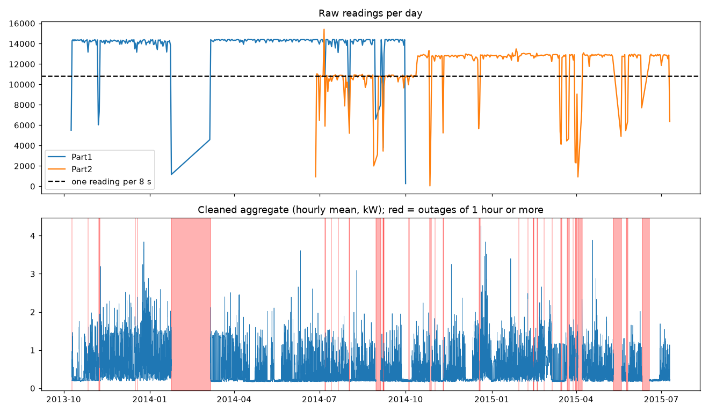

# DATA

## Dataset

**REFIT Electrical Load Measurements** (University of Strathclyde, Murray et al. 2017):
20 UK homes, 2013–2015. Each home has one clamp on the main cable (**aggregate**) and 9 smart plugs (appliances).
Active power in **watts**, one reading every **6–8 seconds**. Licence CC BY 4.0.

| Used for | Files | Homes | Period |
|---|---|---|---|
| Part 1 (cleaning) | `RAW_House1_Part1.csv`, `RAW_House1_Part2.csv` | 1 | 9 Oct 2013 – 10 Jul 2015 |
| Parts 2–3 | `CLEAN_House1/2/5/7/8/9.csv` | 1, 2, 5, 7, 8, 9 | full period of each home (Sep 2013 – Jul 2015) |

Known limitations (readme): the official cleaned data is **forward-filled** (gaps filled with the last value), plug
spikes above 4 kW were set to 0, sensors are not synchronised, people could move plugs, and there are outages
(notably February 2014). Homes 1, 8 and 9 also have a separate washer-dryer.

## Raw House 1: what I found

| Check | Result |
|---|---|
| Rows | Part1 4,377,877 (Oct 2013 – Oct 2014), Part2 4,140,886 (Jun 2014 – Jul 2015) |
| Missing values | none in Part1; up to 1.9 M per column in Part2 (sensors are logged only when they change) |
| Time order | Part1 has 1 row out of order |
| **Time zone** | Part1 timestamps are UK local time: 1 hour off in summer (found by plotting against the official data) |
| **Overlap** | 944,950 Part2 rows in Part1's period; Part2 misses 5.8 % of aggregate values there, Part1 none |
| Duplicates | 884,707 exact duplicate rows; 1.2 M rows share a timestamp (including the overlap) |
| Sampling | median 7 s; 390 gaps > 5 min, 21 > 1 hour, longest 41.6 days (Feb 2014) |
| Impossible values | 77 aggregate readings > 23 kW (max 29 kW); ~3,900 plug readings > 4 kW (max 98,301 W; 65,535 = 16-bit glitch) |
| Frozen sensors | e.g. the aggregate stays at exactly the same value for hours |

## Cleaning steps

1. Convert Part1 time from UK local time to UTC (1,199 rows in the autumn clock-change hour can't be placed → dropped).
2. Overlap: keep Part1.
3. Negative, aggregate > 23 kW, plug > 4 kW → missing.
4. Sort by time; duplicate timestamps → keep the first row.
5. Resample to 1-minute mean.
6. Frozen sensor (same non-zero value ≥ 30 min) → missing: 9,588 minutes.
7. Gaps ≤ 5 min → linear interpolation (759 minutes); longer gaps → marked as outage, **left empty**.

Result: 920,091 one-minute rows; **13.3 % of minutes are outages** (420 outages, 33 longer than an hour, the
longest 6 weeks in Feb–Mar 2014). Check: our cleaned aggregate vs the official cleaned data has correlation
**0.999** and a mean difference of **4 W**.

## Data used in Parts 2–3

The same rules (sort, duplicates, 1 minute, frozen sensors, gaps ≤ 5 min) applied to the official cleaned files:

| house | period | % minutes missing | % frozen (removed) |
|---|---|---|---|
| 1 | 2013-10-09 → 2015-07-10 | 13.0 | 0.33 |
| 2 | 2013-09-17 → 2015-05-28 | 25.4 | 0.77 |
| 5 | 2013-09-26 → 2015-07-06 | 11.7 | 2.36 |
| 7 | 2013-11-01 → 2015-07-08 | 13.2 | 0.62 |
| 8 | 2013-11-01 → 2015-05-10 | 11.4 | 1.13 |
| 9 | 2013-12-17 → 2015-07-08 | 20.1 | 4.72 |

## Remaining concerns

- A sensor stuck at 0 W looks like "off" and is not caught by the frozen-sensor rule.
- Interpolating up to 5 minutes can slightly smooth a peak.
- "Keep the first duplicate" is a simple rule; for conflicting duplicates we can't know which value is right.
- I did not reproduce REFIT's specialised fixes (e.g. moving appliance columns when plugs were swapped).
