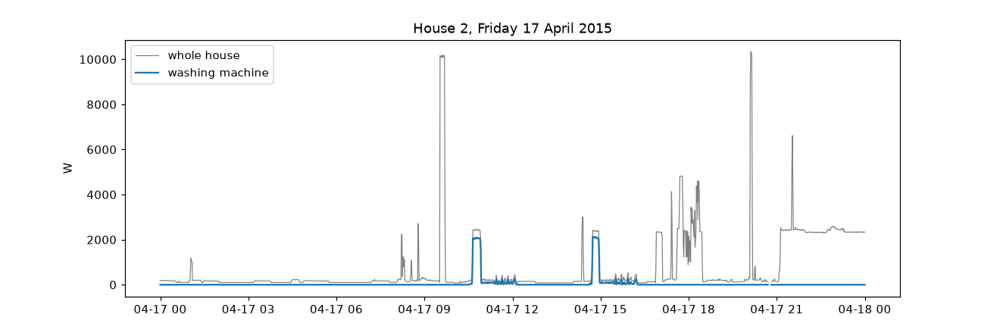
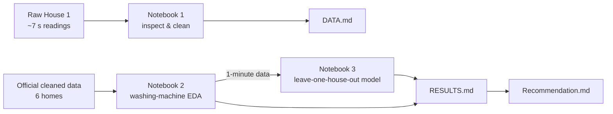
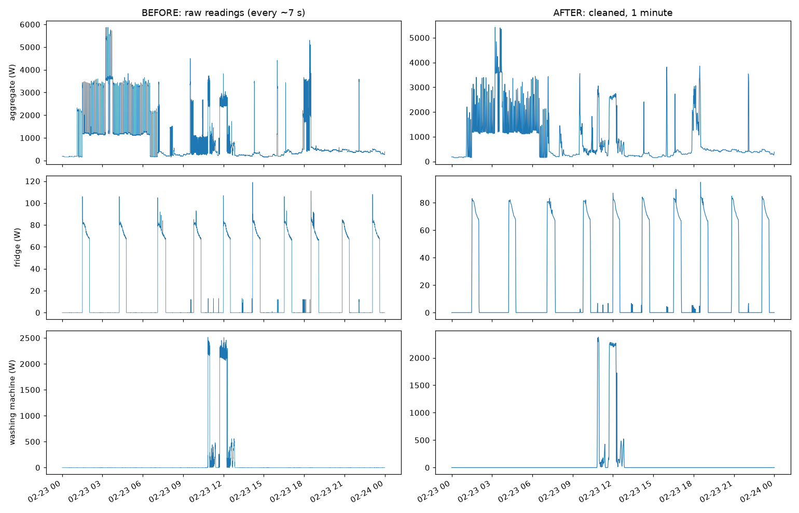
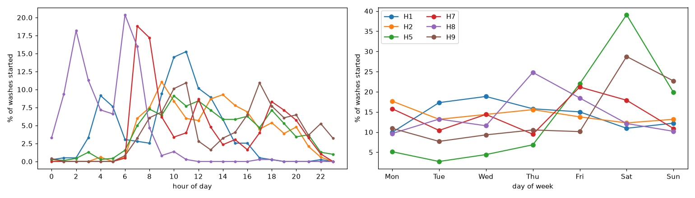
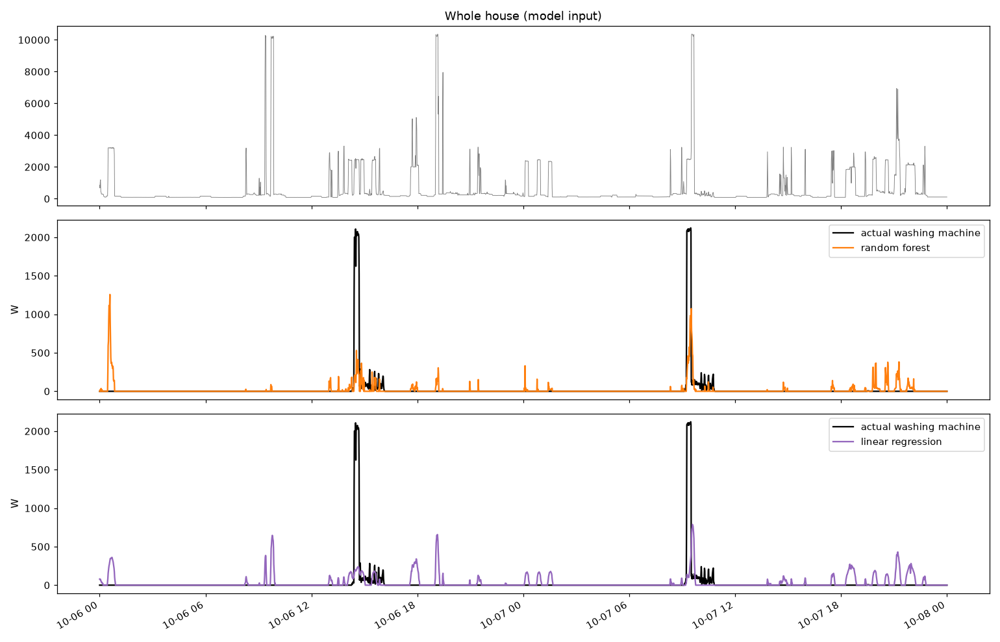
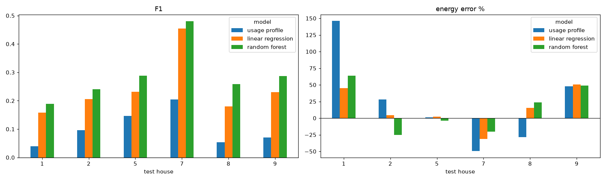

# REFIT – Data Cleaning & Washing-Machine Disaggregation


> **Can we tell when a washing machine is running using only the whole-house smart meter?**

Using the **REFIT** dataset (20 UK homes, 2013–2015, one reading every ~7 seconds), this project:

1. **cleans the raw data** of House 1 and resamples it to 1 minute,
2. **explores washing-machine use** in 6 homes,
3. **trains a model** that estimates washing-machine power from the whole-house signal, tested on homes it has never seen,
4. **turns the results into advice** for an electricity utility.

<p align="center">
  
  <br><em>A day in House 2: each wash shows up as a ~2 kW block inside the whole-house signal (grey).</em>
</p>

---

## Key results at a glance

| | |
|---|---|
| **Raw data problems found** | clock 1 h off in summer, 3-month file overlap, ~885k duplicate rows, values up to 98 kW, frozen sensors |
| **Cleaning check** | correlation **0.999** with the official cleaned data |
| **Washes detected** | **2,893** across 6 homes (3–10 per week) |
| **Evening-peak washing** | **17.5 %** of washes start between 16:00 and 20:00 |
| **Model (random forest)** | finds **~2/3** of washing minutes in an unseen home, F1 **0.29** (≈3× the baseline) |

---

## Project structure

| File | Content |
|---|---|
| [`notebooks/1_cleaning_raw_house1.ipynb`](notebooks/1_cleaning_raw_house1.ipynb) | Part 1: inspection and cleaning of raw House 1 |
| [`notebooks/2_washing_machine_eda.ipynb`](notebooks/2_washing_machine_eda.ipynb) | Part 2: washing-machine analysis |
| [`notebooks/3_disaggregation_model.ipynb`](notebooks/3_disaggregation_model.ipynb) | Part 3: model and evaluation |
| [`DATA.md`](DATA.md) | data coverage, quality problems, cleaning decisions |
| [`RESULTS.md`](RESULTS.md) | EDA and model results, failure cases |
| [`Recommendation.md`](Recommendation.md) | one-page summary for a utility + answers to Section 4 |



---

## How to run

```bash
python3 -m venv .venv
source .venv/bin/activate
pip install -r requirements.txt
jupyter notebook
```

Download the data in a browser (the site blocks scripts) and extract it into this folder:

- `REFIT_RAW_081116.7z` → `REFIT_RAW_081116/` (only `RAW_House1_Part1.csv` and `RAW_House1_Part2.csv` are used)
- `CLEAN_REFIT_081116.7z` → `CLEAN_REFIT_081116/` (`CLEAN_House1/2/5/7/8/9.csv` are used)

Run the notebooks **in order** (1 → 2 → 3). Notebook 2 saves the 1-minute data to `data/`, which notebook 3 uses.
Running everything takes about 15 minutes. Random seeds are fixed, so results are reproducible.

---

## Part 1 – Cleaning the raw data

<p align="center">
  
  <br><em>Before (raw ~7 s readings) and after (cleaned, 1 minute): fridge cycles and the washing machine's heating block survive the cleaning.</em>
</p>

**Main decisions and assumptions**

- **Resolution:** 1-minute mean of the ~7-second readings.
- **Time:** raw Part1 timestamps turned out to be UK local time (1 h off in summer), so I converted them to UTC.
  Hour-of-day analysis uses UK local time.
- **Overlap:** Part1 and Part2 overlap for 3 months; I kept Part1 there (Part2 has 5.8 % missing values there).
- **Duplicates:** same timestamp → keep the first row.
- **Impossible values:** negative, aggregate > 23 kW (100 A fuse × 230 V), plug > 4 kW → missing.
- **Frozen sensors:** the same non-zero value for 30+ minutes → missing.
- **Gaps:** ≤ 5 minutes interpolated; longer gaps marked as outage and **not filled**.
- **Washing-machine cycle:** > 20 W; pauses ≤ 10 min belong to the same wash; at least 10 min and 0.05 kWh.
- **Washing-machine columns** (from the readme): H1 Appliance5, H2 Appliance2, H5 Appliance3, H7 Appliance5,
  H8 Appliance4, H9 Appliance3.

---

## Part 2 – When do people wash?

<p align="center">
  
  <br><em>Most washes start in the morning; House 8 washes at night, House 9 often in the evening.</em>
</p>

---

## Part 3 – Model

### Validation design

**Leave one house out:** train on 5 homes, test on the 6th, repeat for every home. A random split of minutes would
leak information (neighbouring minutes of the same wash are almost identical). Splitting by home avoids that, and it
answers the real question: does the model work in a new customer's home?

### Models and trade-offs

- Input: whole-house power from 15 minutes before to 15 minutes after the minute we predict, plus a few window
  statistics, hour and weekday (window idea from Seq2Point, Zhang et al. 2018).
- Models: always-off and usage-profile baselines, linear regression, **random forest** (main model).
- Random forest was chosen because it is simple, handles non-linear patterns (the *shape* of a 2 kW block) and is
  easy to explain. An earlier test with gradient boosting and a small neural network did not do better.
- Using 15 minutes of "future" data is fine for analysing past data, but not for real-time use.
- Training uses a random sample of 400,000 minutes per run to keep it fast.

| Model | F1 | Recall | Precision | MAE (W) |
|---|---|---|---|---|
| Always off | 0.00 | 0.00 | 0.00 | 22.4 |
| Usage profile | 0.10 | 0.51 | 0.06 | 42.1 |
| Linear regression | 0.24 | 0.77 | 0.15 | 38.1 |
| **Random forest** | **0.29** | 0.67 | **0.19** | 34.4 |

<p align="center">
  
  <br><em>House 2, never seen during training: both washes are found at the right time, but their power is under-estimated.</em>
</p>

<p align="center">
  
  <br><em>The random forest beats the baselines in every home; accuracy varies a lot between homes.</em>
</p>

---

## AI tools used

I used an AI assistant to help debug code and to draft the documents. I reviewed the choices, ran everything on the
real data, and checked the results (for example the time-zone problem and the frozen sensors were found by looking at
plots and comparing with the official data).

## Possible improvements

- A Seq2Point-style neural network with a longer window (1–2 hours) to see the whole wash.
- More training homes (REFIT has more homes with a washing machine).
- Remove predicted "washes" shorter than 10 minutes to cut false alarms.
- Test on another dataset (e.g. UK-DALE) and on Indian data.

## References

1. Murray, D., Stankovic, L., Stankovic, V. (2017). *An electrical load measurements dataset of United Kingdom
   households from a two-year longitudinal study.* Scientific Data 4, 160122. – dataset description.
2. Zhang, C. et al. (2018). *Sequence-to-point learning with neural networks for non-intrusive load monitoring.*
   AAAI. – idea of predicting the middle point of a window of the aggregate.
3. Kelly, J., Knottenbelt, W. (2015). *Neural NILM: Deep neural networks applied to energy disaggregation.*
   BuildSys. – testing on unseen houses, on/off threshold and F1 as a metric.
