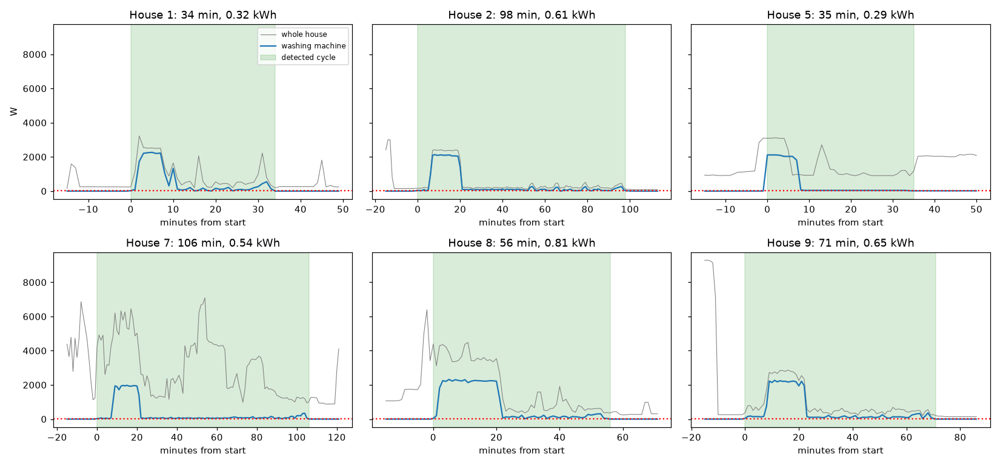
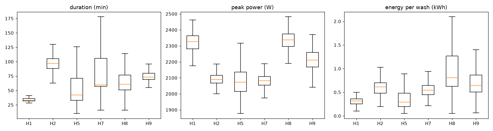
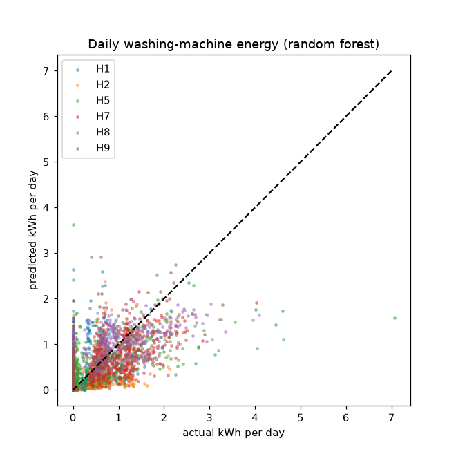
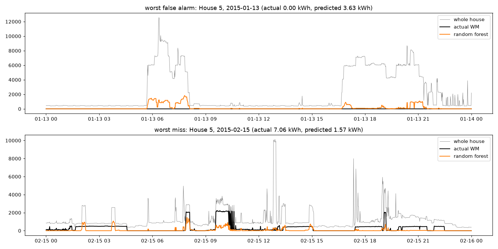

# RESULTS

Data: official cleaned REFIT, homes **1, 2, 5, 7, 8, 9**, full period of each home (Sep 2013 – Jul 2015), 1 minute.
Details and code: `notebooks/2_washing_machine_eda.ipynb` and `notebooks/3_disaggregation_model.ipynb`.

## Part 2 – Washing-machine EDA

**Cycle rule:** the machine is on when it uses more than **20 W**. On-minutes with pauses of up to **10 minutes**
belong to the same wash (machines pause to soak or fill). A wash must last at least **10 minutes** and use at least
**0.05 kWh**. Standby is 0–5 W and real washing is above 100 W, so 20 W separates them safely.

| house | days | % missing | % time off | washes | per week | median duration | median peak | median kWh/wash |
|---|---|---|---|---|---|---|---|---|
| 1 | 638 | 13.0 | 98.2 | 393 | 4.3 | 33 min | 2326 W | 0.32 |
| 2 | 617 | 25.4 | 95.3 | 334 | 3.8 | 97 min | 2090 W | 0.61 |
| 5 | 648 | 11.7 | 94.6 | 701 | 7.6 | 42 min | 2074 W | 0.29 |
| 7 | 613 | 13.2 | 91.6 | 855 | 9.8 | 60 min | 2083 W | 0.54 |
| 8 | 555 | 11.4 | 96.7 | 363 | 4.6 | 61 min | 2338 W | 0.81 |
| 9 | 568 | 20.1 | 97.2 | 247 | 3.0 | 73 min | 2210 W | 0.65 |

- 2,893 washes in total, 3–10 per week. The washing machine is off 92–98 % of the time.
- Every machine peaks at 2.1–2.3 kW (the water heater), which is the pattern we look for in the whole-house signal.

**When people wash:** mostly in the morning. House 8 washes mainly at night (56 %, around 2 am), probably a cheap
night tariff with a delay timer. House 9 does 43 % of its washes in the evening. Houses 5 and 9 wash mostly at
weekends. **17.5 % of all washes start between 16:00 and 20:00**, the busiest time on the grid (31 % in House 9).

**(i) Representative day:** two washes in House 2, each a ~2 kW block for 15–20 minutes followed by a low tail.
Another ~2.3 kW block at 17:00 is not the washing machine (probably the dishwasher): a look-alike.

**(ii) Detected cycles:** the rule catches each wash as one piece, including pauses. Programmes differ from about
30 minutes (House 1) to about 100 minutes (Houses 2 and 7).

**(iii) Comparing homes:** duration differs most (33 vs 97 min), peak power is similar (2.1–2.3 kW), energy per wash
differs almost 3x (0.29 vs 0.81 kWh). Homes are quite different, which makes a new home hard for a model.

## Part 3 – Disaggregation model

**Setup**
- Input for each minute: whole-house power from 15 min before to 15 min after, window mean/std/max/min, power above
  the base load, hour and weekday. Target: washing-machine power.
- Models: always off, usage profile (mean by weekday and hour), linear regression, **random forest**
  (50 trees, max depth 15, trained on a random 400,000 minutes).
- Predictions below 20 W are set to 0.
- **Split: leave one house out** (train on 5 homes, test on the 6th, 6 times). A random split of minutes would leak:
  neighbouring minutes of the same wash are almost identical and would end up in both train and test.

**Metrics:** MAE (average error per minute); precision, recall and F1 on "on" minutes (> 20 W), to see whether washes
are found without false alarms; energy error % (is the total right?).

**Results (average over the 6 test homes)**

| model | MAE (W) | precision | recall | F1 | energy error % |
|---|---|---|---|---|---|
| always off | 22.4 | 0 | 0 | 0 | −100 |
| usage profile | 42.1 | 0.06 | 0.51 | 0.10 | +24 |
| linear regression | 38.1 | 0.15 | 0.77 | 0.24 | +14 |
| **random forest** | 34.4 | **0.19** | 0.67 | **0.29** | +14 |

- Always off has the lowest MAE but finds nothing, so MAE alone is misleading for an appliance that is off ~95 % of
  the time.
- The random forest has the best F1 and beats the usage profile in every home. It finds ~2/3 of washing minutes, but
  only ~1 in 5 of its "on" predictions is right.
- Per home the random forest's F1 ranges from 0.19 (House 1) to 0.48 (House 7), and its energy error from −25 % to
  +64 %. Houses with a washer-dryer (1, 8, 9) are over-estimated.
- An earlier test with gradient boosting (F1 0.29) and a small neural network (F1 0.25) did not do better, so I kept
  the simpler random forest.

**Actual vs predicted (House 2, not used in training):** both washes are found at the right time, but the random
forest predicts ~500–1,000 W during a 2,000 W heating block: when it can't be sure it is the washing machine, it
predicts something in between. Linear regression reacts to every rise in power with a smooth bump, because it can't
recognise the *shape* of a long 2 kW block.

**Daily energy:** clear trend but a lot of scatter; busy days are under-estimated.

**Most important features:** power above the base load, hour of day, and the power now and 15 minutes before/after
(does a high level last long, like a heater, or is it short, like a kettle?).

## Failure cases

1. **Look-alike loads** – House 5, 13 Jan 2015: 6–12 kW for hours (probably electric heating) was partly called
   washing (3.6 kWh predicted, 0 real). Kettles, dishwashers, dryers and washer-dryers have similar heaters.
2. **Washes without heating** – House 5, 15 Feb 2015: long ~480 W periods without a heating block (cold/eco washes)
   are almost invisible in the whole-house signal (1.6 kWh predicted, 7.1 real).

## Interpretation

With only the whole-house meter, a simple random forest can find most washing activity in a home it has never seen,
but it makes many false alarms and under-estimates each wash. It is good enough for rough trends over weeks or months
or across many homes, not for exact per-wash or per-appliance numbers.
